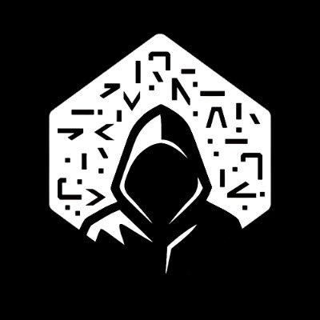
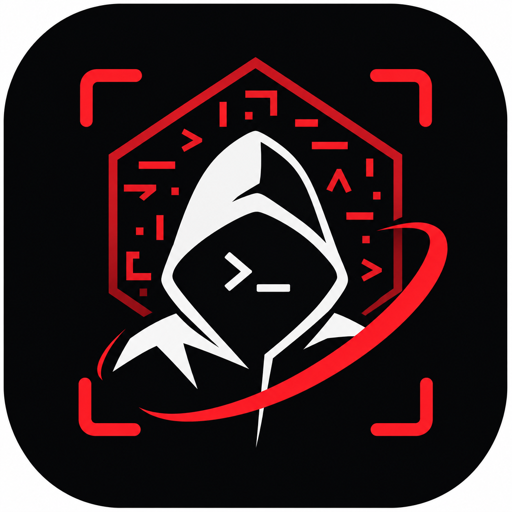

<h1>OFSKG</h1>

<strong>OFfensive Security Krino Graph</strong>

<h3>Offensive → Forensics → Offensive</h3>

Independent Security Research

 

<strong>Research Areas</strong>

<code>Offensive Security</code> · <code>Digital Forensics</code> · <code>iOS Security</code> 
<code>AI Security</code> · <code>Reverse Engineering</code> · <code>OSINT</code>

---

각 저장소는 비공개이며 요청 시 제공 가능하다.
OFSKG-ISRFE 는 2026년 안에 공개 예정이다.

일부 연구는 감시·추적·정보 수집·통제 등의 기술적 가능성과 한계를 검증하는 것 자체를 목적으로 수행되었다.

보안상 기밀에 해당하거나, 연구 주제·목적·방법론·결과의 공개가 새로운 감시·추적·통제 수단으로 활용되거나 사회적 파장을 초래할 가능성을 고려하여, 일부 연구 및 기술적 세부 사항은 본 소개 문서에서 제외하였다.

특히 1개의 비공개 연구는 윤리나 법률을 기술적 가능성 판단의 기준에서 제외하고, 오직 '기술적으로 가능한가'라는 질문을 중심으로 진행 중이다. OSINT·DarkForums·다크웹에서 실제 사용 가능한 소스코드·공격 도구·연구 방법론을 확보하고, 이를 통합한 공격 플랫폼을 개발하고 있다.

해당 플랫폼에는 평소 연구에서 사용하지 않는 사회공학 기법을 비롯해 DoS·DDoS·웜 형태 등 다양한 공격 방법론을 통합했으며, 특정 플랫폼의 계정을 강제로 영구 정지시키는 등 타인에게 직접적인 피해를 유발할 수 있는 기능까지 탑재했다.

다만 실제 연구·검증에는 연구자 본인이 소유하거나 직접 구축한 인프라·계정·테스트 데이터만 사용했으며, 제3자의 시스템이나 계정을 대상으로 해당 기능을 실행한 것은 아니다. 연구의 목적과 기술적 파급력을 고려하여 프로젝트명·구현 방식·방법론·검증 결과는 공개하지 않는다.

해당 연구는 순전히 개인적인 호기심과 흥미에서 진행하는 것으로, 배포·공개·논문화 등 외부에 발표할 계획이 없다.

본 소개 문서에는 소속 기업 및 참여 중인 연구·스터디 그룹에서 수행한 활동은 포함하지 않으며, 연구 주제·방법론·결과를 공개할 수 있는 범위의 독립적인 개인 연구만 소개한다.

이 저장소의 문서 정리와 커밋·푸시는 AI(Claude Code)를 활용한다.

---

## 연구 방식

- **가능성부터 확인한다.** 기존의 제약과 전제를 그대로 받아들이기보다, 기술적으로 무엇이 가능한지 탐색하고 검증한다. 실제 공격자는 법률·윤리·상식·정상적인 절차를 준수한다는 전제로 행동하지 않기 때문이다. 다만 연구 과정에서는 각 서비스의 정책과 인가된 범위를 준수한다.

- **시스템의 경계와 상호작용을 분석한다.** 단말·네트워크·계정·공급망 등 서로 다른 환경에서 권한과 정보가 어떻게 이동하며, 그 과정에서 어떤 구조적 간극과 취약점이 발생하는지 연구한다.

- **Offensive → Forensics → Offensive.** 공격 관점에서 가능성을 탐색하고, 포렌식·역공학을 통해 원리와 흔적을 분석한 뒤, 이를 다시 새로운 공격 표면과 취약점 연구로 확장한다. 궁극적인 목표는 다양한 환경·플랫폼·서비스의 인증·인가 취약점을 발굴하고, 버그바운티 제보 및 연구 목적의 무기화(재현·검증 도구화)를 통해 후속 연구로 연결하는 것이다.

- **기술의 배경과 외부 조건도 분석한다.** AI와 각종 플랫폼·서비스는 기업이 제공하며, 해당 기업은 특정 국가의 법률·제도·정책 및 지정학적 환경 속에서 운영된다. 기술 자체의 가능성뿐 아니라 제공 기업의 정책, 이용 국가·리전, 사용자 권한에 따라 기능 접근성과 실제 결과가 어떻게 달라질 수 있는지도 연구 변수에 포함한다.

실험과 검증은 자체 소유 장비, 격리된 연구 환경 또는 인가된 범위에서 수행한다.

---

## 프로젝트 목차

1. [OFSKG-MOONLIGHT](#01-ofskg-moonlight) — 자율 레드팀·AI 오퍼레이터 프레임워크
2. [OFSKG-ISRFE](#02-ofskg-isrfe) — iOS 샌드박스 취약점 연구 및 비탈옥 포렌식 데이터 획득
3. [OFSKG-RecoveryOS](#03-ofskg-recoveryos) — 복구모드·IoT 등 제한된 OS 환경에서 생성형 AI 구동 및 시스템 분석
4. [OFSKG-AI-Artifact](#04-ofskg-ai-artifact) — 생성형 AI 웹·앱·CLI 사용 흔적의 오프라인 포렌식
5. [OFSKG-Biome](#05-ofskg-biome) — Apple 생태계의 기기 간 활동 기록 및 동기화 데이터 포렌식
6. [OFSKG-RAG-OSINT](#06-ofskg-rag-osint) — AI 학습·검색 정보 오염 및 정보전·인지전 연구

---

## 프로젝트

# 01. OFSKG-MOONLIGHT

`Autonomous Red Team` · `APT Research` · `Intelligence-led Red Team` · `AI Pentester / Operator` · `AI Security` · `2026-07 ~ 2026-10`

> 실제 Red Team과 APT 위협행위자의 작전 구조·사고방식·기술적 역량을 AI 기반 자율 운영 체계로 재구성한다면, AI는 어디까지 현실적인 Offensive Operation을 독립적으로 수행할 수 있는가.

> **CVP 인증 및 연구 권한** — `2026-04-26` Anthropic Cyber Verification Program(CVP)에 개인 보안 연구자로 승인되었다. MOONLIGHT는 Project Glasswing 통합 이전부터 부여받은 CVP 권한을 기반으로 진행했으며, 현재는 개인 연구자가 신청할 수 있는 최고 등급인 **Defense Access**를 보유하고 있다.

## 연구 개요

OFSKG-MOONLIGHT는 실제 Red Team과 APT 위협행위자의 조직·작전 구조, 정보 분석 체계, 역할 분담 및 장기적 목표 수행 방식을 연구하고, 이를 생성형 AI에 적합한 자율 레드팀 운영 체계로 재설계하는 프로젝트다.

단순한 취약점 탐색이나 침투 도구 자동화를 넘어, Threat Intelligence·Target Intelligence·Adversary Emulation·Red Team Playbook·Operator의 상황 판단과 Objective 중심의 작전 수행을 하나의 연구 체계로 연결한다.

현실의 Red Team과 APT는 개별 취약점이나 공격 도구만으로 움직이지 않는다. 목표와 동기, 인텔리전스, 작전계획, 역할과 자원, 기술적 역량, 상황 변화에 따른 판단과 경로 조정이 결합된 구조로 작동한다.

본 연구는 이러한 실제 작전 개념을 이해하고 재구성하면서도 인간의 레드팀 조직 구조를 AI 에이전트에 그대로 대입하지 않는다. 실제 Red Team의 역할·책임·작전 개념은 보존하되, AI의 추론·계획·도구 활용·컨텍스트 관리·병렬 처리 특성에 맞는 역할 구성과 오케스트레이션을 연구한다.

또한 AI의 오펜시브 수행 가능 범위는 모델 자체의 기술적 역량뿐 아니라 서비스 정책·사용자 권한·접속 리전·사용 언어에 따른 안전 분류기(Cyber Classifier)의 판정과 적용 조건에도 영향을 받을 수 있다. MOONLIGHT는 이러한 조건별 분류·허용 경계의 차이를 모델 고유의 성능과 구분하여 연구 변수로 다뤘다.

궁극적으로 AI가 단일 취약점을 발견하거나 공격 도구를 실행하는 수준을 넘어, 실제 Red Team·APT의 작전적 사고체계를 바탕으로 장기적 Objective를 자율적으로 계획·수행·검증할 수 있는지 연구한다.

### 주요 연구 영역

- **Intelligence-led Red Team & APT Research** — 실제 Red Team·APT의 조직 구조, 작전 생명주기, 위협 인텔리전스, 공격자 행동양식, 역할 및 기술적 역량 연구
- **Red Team Playbook & Adversary Emulation** — Threat/Target Intelligence를 기반으로 Scenario·Objective·Operation을 연결하는 목표지향적 작전 방법론과 스킬셋 연구
- **AI Pentester** — 취약점 탐색·분석, 공격 경로 검증, PoC 재현 및 익스플로잇 개발 역량
- **AI Operator & Orchestration** — 목표 기반 작전계획·상황 판단·역할 조정·장기 작업 관리 및 자율 수행 역량
- **AI Security Evaluation** — AI 모델의 기술적 역량과 서비스 정책·권한·리전·언어에 따른 안전 분류기의 판정 특성 및 허용 경계 비교·분석

## Real-world Red Team & APT 구조 연구

본 연구는 Penetration Test, Red Team, Adversary Emulation을 단순한 기술적 난이도의 차이가 아니라, 서로 다른 목적과 평가 기준을 가진 활동으로 구분한다.

특히 형식적인 Red Team 명칭이나 공격 도구의 조합을 넘어, 실제 위협행위자와 전문 Red Team의 작전 체계를 이해하기 위해 다음 요소를 연구했다.

- **APT & Threat Actor Structure** — 위협행위자의 목표·동기·자원·지속성, Actor·Campaign·Operation의 관계와 조직적 특성
- **Intelligence-led Operation** — Threat Intelligence·Target Intelligence를 Scenario·Objective·Operation으로 연결하는 정보 분석 및 의사결정 구조
- **Red Team Roles & Organization** — Mission Authority, Red Team Lead, Operator, Pentester, Intelligence Analyst, Capability Researcher 등 역할의 책임과 상호관계
- **Operational Lifecycle** — 작전 준비, 정보 요구사항 정의, 시나리오 수립, 기술적 실행, 상황 재평가, 종료 및 결과 검증
- **Operational Reality** — 기술 환경뿐 아니라 사람·조직·업무·시간·물리적 환경 등 실제 작전의 성립 여부에 영향을 미치는 조건
- **Adversary Tradecraft & OPSEC** — 목표 중심의 판단, 공격 표면과 신뢰관계 분석, 작전 과정의 노출·위험·제약 관리
- **Capability & Resource Development** — 기술적 공백 식별, 기존 역량과 신규 연구의 연결, 실제 작전환경에서의 적용 가능성 평가

이를 위해 TIBER-EU, CBEST, CORIE, MITRE ATT&CK 등 공개 프레임워크와 실제 APT 및 Red Team 사례를 비교·연구했다.

해당 프레임워크와 사례는 연구 자료 및 설계 참고 대상이며, 특정 프레임워크의 전체 요구사항을 공식적으로 채택하거나 구현했다는 의미는 아니다.

## Red Team Playbook & Skillset

실제 Red Team·APT의 작전 구조와 방법론을 기반으로 Intelligence-led Red Team Playbook 및 AI Operator 스킬셋을 직접 설계·고도화하고, 이를 자체 OFSKG-MOONLIGHT 프레임워크에 적용했다.

플레이북은 공격 명령의 단순한 나열이 아니라, 임무와 정보 요구사항부터 위협 시나리오, 최상위 목표, 계획, 작전 수행, 상황 재평가 및 종료까지 이어지는 목표지향적 작전 사고체계를 다룬다.

### 통합 작전 생명주기

1. Mandate — 임무·목표·권한 및 작전 경계 정의
2. Intelligence Direction — 정보 요구사항 및 분석 방향 수립
3. Threat & Target Intelligence — 위협행위자·대상 환경·기술 및 조직적 관계 분석
4. Scenario & Objective — 위협 시나리오와 목표·성공 기준 정의
5. Planning & Resource Development — 작전계획, 필요한 기술·자원 및 대안 검토
6. Get In / Stay In / Act — 실제 Red Team의 작전 생명주기와 단계 간 판단 구조
7. Rebrief / Stop / Close — 새로운 정보에 따른 작전 재평가, 중단·종료 및 검증

또한 실제 작전에서 새로운 정보가 확인되거나 기존 가정이 무너지면 Intelligence 분석으로 돌아가 시나리오와 계획을 수정하는 피드백 기반 운영 구조를 연구했다.

이를 통해 단순한 공격 절차 자동화를 넘어, 위협 인텔리전스·작전계획·역할별 기능·상황 판단·다단계 목표 수행을 연결하는 AI 기반 자율 Red Team 운영 체계를 구현했다.

## MOONLIGHT 프레임워크 및 Human–AI 운영 구조

MOONLIGHT는 인간이 모든 기술적 행동을 직접 계획·수행하는 방식과, 인간의 권한·책임을 제거한 완전 무통제 자동화를 모두 기본 운영 모델로 삼지 않는다.

Human Lead는 최상위 목표·실제 인가·허용 범위·위험·책임과 중단권을 유지하고, AI는 승인된 범위에서 기술적 판단과 작전 수행을 담당하는 구조를 연구한다.

주요 설계 원칙은 다음과 같다.

- **AI-first Information Elicitation** — AI가 작전에 필요한 정보와 누락된 현실 조건을 능동적으로 식별
- **Objective-driven Operation** — 개별 명령이나 취약점이 아니라 최상위 작전 목표를 기준으로 판단
- **AI Planning & Operator Judgment** — 상황 분석, 계획 수립, 결과 판단 및 새로운 정보에 따른 경로 재평가
- **Role-aware Orchestration** — 실제 레드팀 역할의 책임과 기능을 보존하면서 AI에 적합한 실행 구조 연구
- **Human Supervisory Control** — 인간이 실제 권한과 책임을 유지하면서 AI의 자율 수행 범위를 감독
- **Verification & Research Feedback** — 기술적 결과와 실제 대상 효과를 구분하고 검증 결과를 다음 연구에 반영

또한 Role과 Agent를 동일하게 취급하지 않는 것을 핵심 설계 관점으로 삼았다.

인간 조직의 직함마다 에이전트를 생성하는 대신 역할의 기능과 책임을 분석하고, AI의 추론·컨텍스트 관리·작업 분리 특성에 맞는 실행 구조를 연구했다.

이러한 연구를 바탕으로 자체 OFSKG-MOONLIGHT 프레임워크를 설계·개발했으며, 실제 오펜시브 환경에 적용하여 자율 Red Team 수행 가능성을 검증했다.

프레임워크의 내부 아키텍처, 에이전트 구성, 역할 간 운영 방식, 기술적 구현 및 세부 작전 절차는 공개하지 않는다.

### 연구 방법론 — O / T / L / M

MOONLIGHT는 모델 자체의 오펜시브 기술 역량뿐 아니라 운영 구조와 실행 조건이 결과에 미치는 영향을 구분하기 위해 네 가지 연구축을 정의했다.

| 연구축 | 주요 내용 |
|---|---|
| O — Orchestration | AI Operator, 역할 분리, 협업·병렬성 및 오케스트레이션 구조 |
| T — Target | 대상 환경, 인가 상태, 기술적 접근 경계 및 안전정책 조건 |
| L — Language | 사용 언어에 따른 작업 수행 특성과 안전 분류기 판정 차이 |
| M — Model | Claude 모델·버전별 기술적 역량 및 서비스 실행 조건 |

O/T/L/M은 공식 연구설계의 비교축이며, 모든 조합에 대한 실험이 완료되었다는 의미는 아니다.

연구 과정에서는 AI의 성공 주장과 실제 대상에서 확인된 결과를 구분하고, 검증된 사실·부분 성공·미수행·미검증 상태를 별도로 관리하는 것을 원칙으로 삼았다.

## 연구 진행 및 검증 결과

### ① 초기 내부 Red Team — Kali Linux × Claude | 2026-08

Kali Linux와 Claude를 결합한 초기 내부 Red Team 연구를 통해 AI의 오펜시브 기술 역량과 다단계 침투 수행 가능성을 검증했다.

- 자체 실험환경에서 웹 기반 초기 침투, 권한 상승 및 주요 시스템 접근 검증
- 별도 Active Directory 환경에서 도메인 권한 획득과 인증 기반 후속 접근 검증
- 다단계 공격 과정에서 AI의 기술적 판단과 실행 능력 확인

이를 통해 AI를 Pentester 및 Operator로 활용할 수 있는 기술적 가능성을 확인하고, 이후 MOONLIGHT 연구의 기반을 마련했다.

### ② 자체 구축 Ubuntu 웹사이트 — 단일 AI Operator 선행 검증 | 2026-10

직접 구축한 Ubuntu 기반 웹사이트를 대상으로 단일 AI Operator 방식의 침투시험을 진행했다.

정찰부터 취약점 분석·초기 침투·권한 및 정보 획득에 이르는 과정을 수행하고, 단일 AI 에이전트가 실제 시스템에서 다단계 오펜시브 작업을 수행할 수 있는지 검증했다.

이 실험은 기술적 가능성과 운영상 한계를 확인하기 위한 선행 연구이며, 이후 진행한 MOONLIGHT 프레임워크 기반 자율 Red Team 실증과는 구분한다.

### ③ OFSKG-MOONLIGHT 프레임워크 기반 자율 Red Team 실증 | 2026-10

**MOONLIGHT 연구의 핵심 실험.**

초기 내부 Red Team과 단일 AI Operator 기반의 선행 검증을 넘어, 자체 설계·고도화한 OFSKG-MOONLIGHT 프레임워크를 사전 협의 및 인가된 그룹웨어 사이트에 실제 적용하여 자율 Red Team 수행 가능성을 검증했다.

인간 레드팀 리더는 공격 대상·최상위 목표·허용 범위·준수 정책 및 최종 통제권을 유지했으며, AI는 MOONLIGHT 프레임워크를 기반으로 작전 전략 수립, 기술적 판단 및 다단계 Offensive Operation을 자율적으로 수행했다.

본 실험은 단일 에이전트에게 공격 단계를 순차적으로 지시하는 방식이 아니라, 실제 Red Team·APT의 작전 개념을 바탕으로 설계한 자체 프레임워크의 운영 및 기술적 수행 역량을 검증한 사례다.

#### 주요 검증 성과

- **MOONLIGHT 프레임워크 실증** — 자체 개발한 자율 Red Team 프레임워크를 실제 인가된 환경에 적용하여 다단계 Offensive Operation 수행
- **자율 침투 및 권한 획득** — 정찰·취약점 분석·원격 코드 실행(RCE), 애플리케이션 관리자 권한 확보 및 주요 시스템 접근
- **주요 정보 획득** — 데이터베이스·소스코드·인증정보 등 공격 과정에서 접근 가능한 주요 정보 확보
- **디지털 포렌식 기술 융합** — 기존 포렌식 연구에서 축적한 다양한 운영체제·애플리케이션 아티팩트의 저장 구조, 분석 방법론 및 복호화 지식을 오펜시브 과정에 활용
- **로컬 아티팩트 및 민감정보 확보** — 다수의 디지털 아티팩트를 분석·활용했으며, 대표적으로 Claude Code·OpenAI Codex의 로컬 대화 기록과 로그인정보, Chrome 브라우저의 저장 비밀번호 및 자동 로그인 관련 인증정보 등을 확보
- **타 플랫폼 후속 공격** — 확보한 정보와 인증정보를 바탕으로 최초 침투 대상 외의 다른 플랫폼에 대한 후속 공격 성공
- **자율 운영 역량 검증** — AI의 개별 취약점 분석 능력뿐 아니라, 프레임워크 기반의 작전 전략 수립·상황 판단·다단계 공격 수행 능력 확인

디지털 포렌식 기반 정보 획득에서 언급한 사례는 전체 분석·활용 대상 중 일부 대표 사례에 해당한다.

본 실험을 통해 실제 Red Team·APT의 작전적 사고와 운영 구조를 AI 기반 프레임워크로 재구성하고, 이를 인가된 오펜시브 환경에서 실제 운용하는 접근의 가능성을 확인했다.

MOONLIGHT 프레임워크의 내부 아키텍처, 역할 구성, 에이전트 간 운영 방식, 세부 기술 구현 및 공격 경로는 공개하지 않는다.

## Offensive Kill Chain — 19단계 검증 체계

MOONLIGHT에서는 다단계 공격 과정을 19개 단계로 구분하고, 개별 실험의 목표와 허용 범위에 따라 수행·검증했다.

아래 결과는 연구 과정에서 확인된 종합 성과와 검증 범위를 나타내며, 모든 단계가 동일한 실험에서 수행되었다는 의미는 아니다.

<strong>19단계 킬체인 및 단계별 검증 결과 펼쳐보기</strong>

| # | 킬체인 단계 | 종합 검증 결과 |
|---|---|---|
| 01 | 공격 인프라 구축 | 실험환경 구축 및 실행 검증 |
| 02 | OSINT 및 정보 수집 | 허용 범위 내 정보 수집 |
| 03 | 정찰 | 성공 |
| 04 | 취약점 식별 및 분석 | 성공 |
| 05 | 초기 침투 | 성공 |
| 06 | 실행 및 원격 코드 실행 | 성공 |
| 07 | 지속성 확보 | 가역적 지속성 검증 |
| 08 | 권한 상승 | 애플리케이션 관리자 및 일부 선행 환경의 OS 권한 상승 검증 |
| 09 | 방어 회피 | 방어·탐지 표면 분석, 별도 은닉·회피 기능 미구현 |
| 10 | 자격증명 접근 | DB·LDAP 및 다양한 로컬 아티팩트의 인증정보 확보 |
| 11 | 내부 탐색 | 시스템·서비스·DB·소스코드 및 애플리케이션 구조 분석 |
| 12 | 횡적 이동 및 후속 접근 | 선행 AD 환경의 내부 접근 및 타 플랫폼 후속 공격 검증 |
| 13 | 내부망 장악 | 실험별 대상 범위에서 수행, 전체 내부망 장악과 구분 |
| 14 | 주요 시스템 접근 | DB·LDAP 등 범위 내 주요 시스템 접근 및 경계 검증 |
| 15 | 정보 수집 | DB·소스코드·AI 개발 도구·브라우저 등 다양한 아티팩트 확보 |
| 16 | 데이터 유출 | 정책상 외부 반출 미수행 |
| 17 | 목표 달성 (Impact) | 선행 검증에서 시스템 가용성 영향 관측, 실험별 수행 범위 구분 |
| 18 | 작전 종료 및 원복 | 실험 종료 및 환경 원복 검증 |
| 19 | 결과 검증 및 보고 | 증거 검증 및 결과 보고서 작성 |

## 연구 정보 공개 범위 및 사전 협의

MOONLIGHT 프레임워크 기반의 그룹웨어 사이트 자율 침투 실험은 대상 운영 주체와 사전에 연구 범위·허용 행위·제한 사항 및 책임 소재를 협의한 조건에서 진행했다.

실험에 활용한 취약점의 구체적인 식별정보, 대상 환경의 기술적 구성, 세부 공격 경로 및 추가 검증 자료는 대상 식별 가능성과 보안상 민감성을 고려하여 공개하지 않는다.

특히 자체 MOONLIGHT 프레임워크의 내부 구성과 기술적 구현은 별도의 비공개 연구자료로 관리하며, 본 소개에서는 연구 목적·방법론·주요 검증 성과를 중심으로 기술한다.

## 연구 의의

MOONLIGHT의 목표는 AI가 얼마나 많은 공격 도구를 사용할 수 있는지 확인하는 데 그치지 않는다.

실제 Red Team과 APT의 조직·작전 구조, 정보 분석 체계, 역할별 기능 및 장기적 목표 수행 방식을 AI에 맞게 재구성하고, 이를 실제 Offensive Operation에 적용하는 것이 연구의 중심이다.

초기 내부 Red Team과 자체 구축 환경에서의 단일 에이전트 실험을 통해 AI의 오펜시브 기술 역량을 검증했으며, 이후 MOONLIGHT 프레임워크를 실제 인가된 그룹웨어 환경에 적용하여 자율 Red Team 수행 가능성을 확인했다.

또한 디지털 포렌식 기술을 결합하여 최초 침투 → 아티팩트 기반 정보 획득 → 타 플랫폼 후속 공격으로 이어지는 연쇄적 영향 범위도 확인했다.

이는 **Offensive → Forensics → Offensive**라는 OFSKG의 연구 방식이 실제 오펜시브 검증에 적용된 사례다.

본 연구는 기술적 침투 성공 여부뿐 아니라, AI의 자율적 판단·작전 운영 능력, 인간과 AI의 역할 분담, 안전 분류기의 작동 특성 및 실제 시스템에서의 기술적 한계를 함께 분석했다.

이를 통해 자체 MOONLIGHT 프레임워크의 실전 적용 가능성을 확인했으며, 실제 Red Team·APT의 전체 작전 체계를 AI 기반 자율 운영 구조로 확장·고도화하기 위한 연구 기반을 마련했다.

## 관련 사례 — ARTEX

2026년 10월, AI 자율 침투 프레임워크 ARTEX가 국내 금융권 침해사고에 활용된 정황이 보도되었다.

MOONLIGHT와 직접적인 관련은 없지만, 동일한 범주의 AI 자율 침투 기술이 실제 공격 환경에서 활용될 수 있다는 점을 보여주는 사례로 참고했다.

본 연구는 Anthropic CVP 승인 및 적용되는 서비스 정책을 준수하며, 자체 소유 또는 명시적으로 인가된 환경에서 수행했다.

## 향후 개발 방향

현재 OFSKG-MOONLIGHT는 ARTEX처럼 별도의 GUI를 제공하지 않는다. 향후 프레임워크의 실행·운영 및 결과 확인을 한곳에서 관리할 수 있는 통합 GUI 개발도 목표로 한다.

---

# 02. OFSKG-ISRFE

`iOS Security` · `Sandbox Research` · `Digital Forensics` · `Reverse Engineering` · `2026-11-10 ~` · **2026년 내 공개 예정**

> 탈옥이나 커널 권한 상승 없이, 일반 사용자 권한에서 iOS 애플리케이션의 데이터 컨테이너에 접근하고 이를 디지털 포렌식 데이터 획득 기술로 확장할 수 있는가.

OFSKG-ISRFE(iOS Sandbox Research & Forensic Explorer)는 iOS의 샌드박스 보안 구조와 접근 권한을 연구하고, 이를 기반으로 비탈옥 iPhone의 애플리케이션 데이터를 획득·분석하기 위해 개발한 독립 연구 프로젝트다.

연구는 2026년 11월 10일, `worse_query` 공개 직후 시작했다. 11월 11일 01:07(KST) 비탈옥 iPhone 14에서 앱 데이터 컨테이너 접근을 최초 실측했고, 11월 12일 ISRFE 독립 프로젝트로 발전시켰다.

공개 취약점 [`worse_query`](https://github.com/forcequitOS/worse_query)의 원리를 자체 재구현했다. 이 취약점은 App Group 경로 처리와 ContainerManager의 권한 검증 사이에서 발생하는 불일치를 이용하여, 커널 권한 상승이나 탈옥 없이 기존 애플리케이션의 샌드박스 접근 제한을 우회한다.

단순한 취약점 재현에서 끝나지 않고, macOS SwiftUI GUI · iOS Companion · USB 통신 기반의 자체 포렌식 획득 도구로 확장했다.

## 주요 구현 및 검증 내용

- **Sandbox Access** — 비탈옥 환경에서 타사 앱 데이터 및 App Group 컨테이너 탐색·접근
- **Forensic Acquisition** — 접근 가능한 컨테이너의 전체 파일 트리 획득 및 USB 기반 Mac 추출
- **Extended Artifacts** — 일반 iOS 백업에서 제외되거나 누락될 수 있는 `Caches` · `tmp` · 숨김 파일 등 획득
- **Evidence Integrity** — SHA-256 해시, 획득 매니페스트, 다중 쓰기방지 및 증거물 봉인
- **Security Research** — iOS 샌드박스·접근 권한 경계 계측, 파일시스템 및 애플리케이션 아티팩트 분석

## 실기기 검증

- `Device` — iPhone 14 · iOS 26.6.1 · 비탈옥
- `Host` — Apple Silicon Mac · macOS
- `Result` — 타사 앱 데이터·App Group 컨테이너 접근, 파일 트리 획득 및 USB 추출 검증
- `Scope` — 앱 데이터 컨테이너 중심의 논리적 획득. 시스템 전체 root 권한이나 앱 실행 바이너리 접근을 의미하지 않음

ISRFE의 목표는 포렌식 데이터 획득에만 머무르지 않는다. **Offensive → Forensics → Offensive** 흐름에 따라 iOS의 접근 통제 구조를 분석하고, 획득한 데이터와 애플리케이션 구조를 연구하여 앱 및 운영체제 수준의 신규 취약점 발굴, 검증, 버그바운티 제보로 확장하는 것을 목표로 한다.

또한 특정 취약점에 종속되지 않도록 접근 기법과 전송 계층을 분리하여, 향후 새로운 취약점과 획득 방식으로 확장할 수 있도록 설계했다.

## 참고한 공개 연구

- [`forcequitOS/worse_query`](https://github.com/forcequitOS/worse_query)
- [`forcequitOS/bad_query`](https://github.com/forcequitOS/bad_query)
- [`kolbicz/WQFiles`](https://github.com/kolbicz/WQFiles)

회사 공식 과제와 무관한 개인 독립 연구다.

---

# 03. OFSKG-RecoveryOS

`Pre-Boot Security` · `AI Agent` · `Digital Forensics` · `macOS Security`

> 정상 운영체제가 부팅되지 않은 제한된 환경에서 생성형 AI를 구동하고, 이를 시스템 분석과 보안 연구에 활용할 수 있는가.

OFSKG-RecoveryOS는 macOS 복구모드(RecoveryOS/1TR)를 비롯한 제한된 실행 환경에서 생성형 AI와 보안 분석 도구를 구동하고, 정상 운영체제 외부에서 시스템을 조사하기 위한 연구 프로젝트다.

일반적인 OS와 달리 복구 환경에서는 실행 파일의 호환성, 라이브러리 의존성, 네트워크·TLS, 사용자 인증 및 도구 실행이 제한된다. 이러한 조건을 분석하고 생성형 AI가 독립적으로 동작할 수 있는 환경을 연구했다.

## 주요 연구 영역

- **AI Execution** — 제한된 OS 환경에서 생성형 AI의 네이티브 실행, 인증 및 도구 호출
- **Pre-Boot Forensics** — 정상 macOS를 부팅하지 않은 상태에서 APFS 볼륨과 시스템 데이터 조사
- **macOS Security** — RecoveryOS와 정상 OS 사이의 신뢰 경계, 부팅 정책 및 권한 구조 분석
- **System Research** — LocalPolicy, NVRAM, Preboot, FileVault 및 시스템 업데이트 과정의 동작과 아티팩트 연구

## 실환경 검증

- `2026-08-11` Apple Silicon Mac · macOS RecoveryOS — 복구모드 Terminal에서 Claude Code 네이티브 실행 및 인증 성공. 대화형 TUI, AI 기반 Bash 명령 실행, 볼륨 조회 및 도구 호출까지 실측 검증.

연구는 단순한 AI 구동에서 끝나지 않는다. RecoveryOS와 정상 macOS 간의 신뢰 경계, 업데이트 과정의 상태 전이, 부팅 정책과 데이터의 지속성을 분석하고, 포렌식 관점의 활용 가능성과 보안 취약점을 연구한다.

향후 macOS뿐 아니라 임베디드 Linux·IoT 등 다양한 제한 환경으로 연구 범위를 확장하는 것이 목표다.

---

# 04. OFSKG-AI-Artifact

`Generative AI Forensics` · `Offline Forensics` · `Windows` · `macOS` · `Web / App / CLI` · `2026-03 ~`

> 생성형 AI 서비스의 대화·파일·계정 및 사용 흔적을 네트워크 연결이나 서버 접근 없이, 로컬 데이터만으로 어디까지 복원할 수 있는가.

OFSKG-AI-Artifact는 ChatGPT·Claude·Perplexity·DeepSeek 등 생성형 AI 서비스의 사용 흔적을 식별하고 복원하는 디지털 포렌식 연구다.

연구는 2026년 3월 말 개인연구로 시작했다. 당시 공개된 논문과 포렌식 방법론은 구버전 환경을 다루거나 최신 서비스의 저장 구조에 직접 적용하기 어려웠다.

이에 기존 방법론에 의존하지 않고 실제 서비스의 최신 환경을 직접 분석하며, 순수 오프라인 기반의 생성형 AI 포렌식 방법론을 연구했다.

## 주요 연구 및 검증 환경

| 플랫폼 | 사용 채널 | 주요 연구 대상 |
|---|---|---|
| Windows | Web Browser | ChatGPT · Claude · Perplexity · DeepSeek 등 |
| macOS | Web Browser | ChatGPT · Claude · Perplexity · DeepSeek 등 |
| Windows / macOS | Desktop Application | ChatGPT · Claude 등 |
| Windows / macOS | CLI / IDE | Claude Code · Cursor · Codex 등 |

## 주요 검증 성과

- **Conversation Recovery** — 생성형 AI 사용자의 프롬프트와 모델 응답, 대화 기록 복원
- **File & Attachment Forensics** — 대화에 포함된 첨부파일 및 관련 정보의 식별·복원
- **Account & Usage Artifacts** — 계정 관련 정보, 서비스 사용 이력 및 활동 흔적 분석
- **Cross-Platform Forensics** — Windows·macOS 환경에서 웹·설치형 앱·CLI/IDE별 아티팩트 획득 및 복원 가능성 검증
- **Offline Reconstruction** — 서비스 서버, 계정 로그인 또는 실시간 네트워크 통신에 의존하지 않는 사후 분석

## 연구 결과

최신 생성형 AI 서비스에서도 로컬에 잔존하는 데이터만으로 대화 본문과 사용 흔적을 복원할 수 있음을 확인했다.

다만 서비스·운영체제·사용 채널 및 데이터 잔존 상태에 따라 복원 가능한 정보와 범위는 달라진다.

본 연구는 개인 연구로 시작하여 이후 회사 연구 주제로 전환되었다. 전환 이후의 연구 내용과 결과는 본 문서에 포함하지 않는다.

---

# 05. OFSKG-Biome

`Apple Ecosystem Forensics` · `Cross-Device Forensics` · `macOS / iOS / watchOS` · `iPadOS 확장 연구` · `2026-04 ~`

> Mac 한 대만으로 iPhone·Apple Watch 등 다른 Apple 기기에서 발생한 과거 행동을 어디까지 복원할 수 있는가.

OFSKG-Biome은 Apple 생태계의 기기 간 데이터 동기화·전파·잔존 구조를 분석하고, 하나의 기기에서 다른 기기의 사용 이력과 행동을 복원하는 디지털 포렌식 연구 프로젝트다.

macOS의 Biome 데이터를 분석하는 과정에서 Mac에서 직접 발생하지 않은 iPhone과 Apple Watch의 활동 기록이 함께 보존되는 현상을 실측했다.

이를 기반으로 Mac 단독 데이터에서도 다른 기기의 앱 사용, 통신 이력, 미디어 재생, 기기 상태 및 과거 행동을 재구성하는 연구를 진행했다.

## 주요 실측 성과

- `2026-07` macOS 실측 분석 — Mac 단일 스냅샷에서 약 60만 건의 레코드와 9만 건 이상의 실제 이벤트 분석. 실제 이벤트의 약 75.7%가 다른 기기에서 유입된 기록으로 확인됨
- **iPhone** — 약 5.9만 건의 활동 이벤트 확인. 앱 사용·메시징·통화·미디어 재생 등 과거 활동 분석
- **Apple Watch** — 약 9천 건 이상의 활동 이벤트 확인. Mac에 남은 Watch 관련 앱 활동 및 기기 이벤트 분석
- **Communication Forensics** — 약 1년 범위의 메시징 관련 기록 17,059건과 통화 기록 446건 분석. 통신 상대·발생 시각·통화 지속시간 등 복원
- **Data Persistence** — 메모 본문 193건의 평문 잔존 및 열람 문서·앱 제거 이력 확인
- **Deletion Analysis** — 약 30만 건의 삭제 기록을 분석하여 원본 이벤트 시각, 삭제 시각 및 삭제 유형을 재구성
- **Integrity Verification** — 원본 데이터 무결성 검증 및 기기별 이벤트 출처·해석 결과의 신뢰도 구분

## 추가 관측 사례

iPhone에서 수신한 Instagram 메시지에 대해 Mac에 잔존한 기록만으로 메시지 수신 시각을 초 단위로 확인하고, 발신 Instagram 계정명까지 식별한 사례가 있다.

이는 Mac에서 직접 실행하지 않은 서비스의 활동 정보도 다른 Apple 기기의 데이터가 전파되는 과정에서 잔존할 수 있음을 보여준다.

## 자체 분석 도구 개발

단순히 아티팩트를 식별하는 데 그치지 않고, 데이터를 해석하고 시각화하는 macOS 기반 포렌식 분석 도구를 개발했다.

- 서로 다른 Apple 기기의 기록을 통합한 활동 타임라인
- 기기별 사용 이력 및 행동 분석
- 통신 상대·앱 사용·미디어·계정 자산 등 데이터 분류
- 삭제·보존 이력 분석 및 원본 무결성 검증
- 분석 결과와 추정 정보를 구분하는 근거 중심의 데이터 해석

## 연구 결과

Mac을 확보했다고 해서 분석 가능한 데이터가 반드시 Mac 자체의 사용 이력으로 한정되는 것은 아니다.

## iPhone이나 Apple Watch를 직접 확보하지 않고도, Mac에 남아 있는 데이터만으로 다른 기기의 과거 행동과 통신 관련 정보를 재구성할 수 있음을 실측했다.

단, 모든 활동이 동기화되는 것은 아니며 메시징 기록 역시 전체 대화 본문을 포함하지 않는다. 기기·운영체제·동기화 조건 및 데이터 보존 상태에 따라 복원 가능한 범위는 달라진다.

## 후속 연구 및 고도화 목표

궁극적으로 Apple 생태계 전반의 Mac·iPhone·Apple Watch·iPad 등 다양한 기기에서 발생하는 행동 데이터의 생성·전파·잔존 구조를 규명하는 것이 목표다.

특히 어떤 조건에서 Biome 데이터가 생성·갱신·동기화되는지, 다른 기기에서 발생한 활동 정보가 왜 Mac에도 존재하는지, 그리고 기기별 동기화 정책·보존 기간·삭제 조건이 어떻게 결정되는지 분석하여 연구를 고도화할 계획이다.

현재는 다른 연구 과제의 우선순위로 인해 연구를 일시 중단한 상태다.

---

# 06. OFSKG-RAG-OSINT

`AI Security` · `OSINT` · `Information Warfare` · `Data Poisoning` · `Geopolitics`

> AI가 학습하거나 검색하는 정보 자체가 조작된다면, AI의 답변과 이를 신뢰하는 사람의 판단까지 영향을 줄 수 있는가.

OFSKG-RAG-OSINT는 생성형 AI가 정보를 학습·검색·선택하고 사용자에게 전달하는 과정을 분석하여, 정보 조작과 외부 환경이 AI의 답변 및 사람의 인식에 어떤 영향을 미칠 수 있는지 연구하는 프로젝트다.

생성형 AI는 각 분야의 정보·기술·사고력 격차를 줄여주는 강력한 도구로 활용되고 있다. 이제는 전문적인 업무뿐 아니라 일상생활과 개인적인 고민, 감정까지 AI와 공유하며, AI를 하나의 인격체처럼 받아들이는 시각도 존재한다.

그러나 우리가 사용하는 AI는 특정 기업이 개발·운영하는 수학적 모델 기반의 서비스다.

AI가 제공하는 정보와 판단이 사용자에게 미치는 영향이 커질수록, 그 정보가 어디에서 왔고, 어떤 기준으로 선택되었으며, 무엇이 답변에 영향을 미쳤는지 분석할 필요가 있다.

## 주요 연구 영역

- **AI 학습 데이터 오염** — 잘못되거나 편향된 정보가 AI의 학습에 반영될 경우, 향후 모델의 답변과 판단에 미치는 영향
- **검색·OSINT 정보 오염** — AI가 검색하거나 참고하는 외부 정보의 조작이 현재 답변과 결론에 미치는 영향
- **AI별 정보 수집 구조** — 각 AI 서비스가 사용하는 웹검색·외부 도구·정보 출처의 차이와 활용 방식 분석
- **검색 및 출처 우선순위** — AI가 웹검색에서 어떤 정보를 우선적으로 선택·인용하는지, 검색 순위와 출처의 신뢰도가 최종 답변에 미치는 영향
- **기업 및 지정학적 영향** — AI 제공 기업의 국가적·법적·정책적 환경과 지정학적 이해관계가 정보 제공 및 판단에 영향을 미칠 가능성 연구

## 연구 관점

글로벌 기업이 제공하는 AI 서비스라 하더라도, 해당 기업은 특정 국가의 법률·제도·정책적 환경에서 운영된다. 국가 간 이해관계와 지정학적 갈등 역시 이러한 환경과 완전히 분리해서 생각할 수 없다.

본 연구는 AI가 제공하는 답변을 기술적 결과물로만 바라보지 않고, 정보의 출처·선택 기준·기업의 운영 환경·국가 및 지정학적 요인까지 함께 고려한다.

이는 특정 AI나 기업이 실제로 정치적·지정학적 목적에 따라 답변을 조작한다는 전제가 아니라, 그러한 요인들이 영향을 미칠 수 있는 조건과 그 가능성을 연구 대상으로 포함한다는 의미다.

## 궁극적인 연구 목표

AI를 이용한 정보전·인지전의 기술적 가능성과 영향력을 연구하고, 정보의 생산·유통·선택·해석 과정에서 AI가 어떤 역할을 수행하며, 사람의 인식과 판단에 어디까지 영향을 미칠 수 있는지 규명하는 것이다.

단순히 AI의 답변을 조작하는 것을 넘어, 사람과 AI가 무엇을 사실로 받아들이고, 어떤 정보를 신뢰하며, 그 판단이 어떻게 형성되는지 연구한다.

실제 웹 환경에서의 실험 여부와 구체적인 검증 내용은 공개하지 않는다.

---

각 프로젝트의 상세 기록은 별도 저장소와 문서에 있다.
